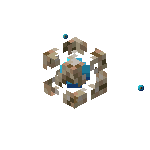

<div align="center">
    
    <h1>Conduit</h1>
</div>

An AI bot for Minecraft servers. Players ask it with `/conduit <request>`, and an AI agent answers
in the chat, using tools that read and change the game. Operators can let it build, fill, teleport,
edit inventories and run commands, while everyone else can ask questions about the world and their
own player.

Conduit is a server-side Fabric mod. Players do not need it to join. The agents run in two Docker
containers next to the server, one for operators and one for everyone else, as
[`agent/README.md`](./agent/README.md) describes. Each uses the agent you pick:
[Claude Code](https://www.anthropic.com/claude-code), [Codex](https://github.com/openai/codex) or
[OpenCode](https://opencode.ai). The mod also serves its tools over
[MCP](https://modelcontextprotocol.io), so other MCP hosts can control the game too.

## Requirements

- The Minecraft and Fabric Loader versions set in [`gradle.properties`](./gradle.properties), and
  the Java version that Minecraft version requires
- [Fabric API](https://modrinth.com/mod/fabric-api) and
  [Fabric Language Kotlin](https://modrinth.com/mod/fabric-language-kotlin)
- Docker with Compose, for the agents
- An API key of the model's provider for each mode

## Setup

1. Put the mod jar in the server's `mods` folder.

2. Set up the agent containers as [`agent/README.md`](./agent/README.md) describes.

3. Give the Minecraft server these environment variables, and start it:

    | Variable                                       | Value                                                                 |
    | ---------------------------------------------- | --------------------------------------------------------------------- |
    | `CONDUIT_FULL_SECRET`, `CONDUIT_CHAT_SECRET`   | The runner secrets of the agent containers                            |
    | `CONDUIT_FULL_API_KEY`, `CONDUIT_CHAT_API_KEY` | The API keys of the modes' [providers](./agent/README.md#credentials) |

4. On the first start, the mod writes `config/conduit.json`. Point it at the agents as
   [networking](./agent/README.md#networking) describes, then run `/conduit reload`.

## Using the bot

`/conduit <request>` asks the bot, such as `/conduit build a small oak cabin next to me`. The bot
posts the question and the answer in the public chat, like a player talking. While a request waits
or runs, the asker's action bar shows how many requests are ahead and then "Thinking…".

Operators and the players in `access.allow` get **full mode**, where the agent can change the game.
Everyone else gets **chat mode**, where the agent can only read the world and the asking player's
own data, such as their inventory, position and statistics, but never another player's data or an
IP address. Each mode has a line of its own, so operators never wait behind chat mode. The bot
answers one request at a time per mode, and each player can have one request in line.

The agent remembers earlier requests. In chat mode every player has a conversation of their own.
In full mode, `requests.memory` picks one conversation per player, one `shared` by everyone, or
`none`.

In full mode the tools record the blocks that each change replaces, so a request such as
`/conduit undo that` can put them back. Undo forgets everything when the server restarts, and it
never brings back entities or dropped items.

### Approvals

Before the agent runs an action that is hard to undo, such as `run_command`, `edit_blocks` `fill`
or `moderation` `kick`, the asker and every online operator get the action with its arguments and
an `[Approve]` and a `[Deny]` button. A click from the asker or an operator decides. When nobody
answers within `approvals.timeoutSeconds`, the action does not run. Either way the agent learns what
happened, and the time spent waiting does not count against the request's timeout.

`approvals.add` and `approvals.remove` change which actions need approval. Each entry is a tool,
such as `edit_player`, or one of its actions, such as `edit_player.game_mode`.

### Operator commands

| Command                                   | Description                                                   |
| ----------------------------------------- | ------------------------------------------------------------- |
| `/conduit status`                         | Each mode's agent, its CLI version, its line and the triggers |
| `/conduit cancel [full\|chat\|<player>]`  | Stops a mode's running request, or a player's request         |
| `/conduit reload`                         | Reloads the config, and keeps the old one if the new is bad   |
| `/conduit forget [<player>\|shared\|all]` | Starts fresh conversations, so the agent forgets earlier ones |

Without an argument, `cancel` and `forget` act on the operator's own request and conversations.

An operator's request runs a command when it is one of these words alone, or `cancel` or `forget`
followed by one more word. Longer requests that start with these words, such as
`/conduit status of the farm`, go to the bot. Requests from other players always go to the bot.

### Triggers

Triggers start full mode runs without a request, on game events or on a timer:

```json
{
    "triggers": [
        {
            "name": "greeter",
            "events": ["player_join"],
            "prompt": "Greet the player who joined with a short chat message.",
            "cooldownSeconds": 60,
            "announce": false
        },
        {
            "name": "news",
            "everyMinutes": 60,
            "prompt": "Tell everyone one fun fact about the world."
        }
    ]
}
```

A trigger has either `events` or `everyMinutes`. `players` limits events to some players, by name
or UUID. The agent gets the event as JSON, and the trigger's `prompt`. With `announce` the bot posts
the answer in the chat, and without it the answer only goes to the log.

An event trigger starts no run within `cooldownSeconds` of its last one, and no trigger has two
runs in line. Each trigger keeps a conversation of its own. Its runs show up as `trigger <name>`,
and the online operators decide its approvals. The event types are the ones the `events` tool lists.

## Configuration

The mod reads `config/conduit.json` at startup and on `/conduit reload`. Fields the file leaves out
keep their defaults. Any string can use `${NAME}` or `${NAME:-default}` to read an environment
variable. The variables of a disabled agent may stay unset.

When the config is invalid at startup, the mod logs the missing variables and invalid fields, and
keeps the bot and the MCP server off until `/conduit reload` loads a valid config. On a reload, the
command lists the problems and keeps the old config.

| Field                                                 | Default                                                       | Description                                                                           |
| ----------------------------------------------------- | ------------------------------------------------------------- | ------------------------------------------------------------------------------------- |
| `mcp.host`                                            | `0.0.0.0`                                                     | Address the MCP server listens on                                                     |
| `mcp.port`                                            | `25585`                                                       | Port of the MCP server                                                                |
| `mcp.allowedHosts`                                    | `minecraft`, `host.docker.internal`, `localhost`, `127.0.0.1` | Host names clients may use to reach the MCP server                                    |
| `mcp.tokens`                                          | none                                                          | Tokens for other [MCP hosts](#other-mcp-hosts)                                        |
| `agents.<mode>.enabled`                               | `true`                                                        | Turns the mode on                                                                     |
| `agents.<mode>.cli`                                   | `claude` for full, `opencode` for chat                        | `claude`, `codex` or `opencode`                                                       |
| `agents.<mode>.model`                                 | `sonnet` for full, `deepseek/deepseek-flash` for chat         | The model, as the CLI names it                                                        |
| `agents.<mode>.effort`                                | `medium` for full, `high` for chat                            | The reasoning effort, as the CLI names it                                             |
| `agents.<mode>.options`                               | none                                                          | Extra options for the CLI's SDK, which Conduit's own options override                 |
| `agents.<mode>.web`                                   | `true` for full, `false` for chat                             | Lets the CLI search and fetch the web                                                 |
| `agents.<mode>.apiKey`                                | `${CONDUIT_<MODE>_API_KEY}`                                   | The API key of the model's [provider](./agent/README.md#credentials)                  |
| `agents.<mode>.dangerouslyUseSubscriptionCredentials` | `false`                                                       | Uses the container's subscription login instead of the API key. See the caution below |
| `agents.<mode>.runner`                                | `http://conduit-<mode>:8080`, `${CONDUIT_<MODE>_SECRET}`      | `url` and `secret` of the mode's agent container                                      |
| `agents.<mode>.mcpUrl`                                | `http://minecraft:25585/mcp`                                  | Where the agent container reaches the MCP server                                      |
| `access.operators`                                    | `true`                                                        | Operators get full mode                                                               |
| `access.allow`                                        | none                                                          | Names or UUIDs of other players who get full mode                                     |
| `tools.readOnly`                                      | `false`                                                       | Full mode only gets the actions that read                                             |
| `tools.chat.allow`                                    | the chat tools below                                          | The only tools chat mode gets                                                         |
| `tools.chat.deny`                                     | none                                                          | Tools chat mode never gets. Without `allow`, it gets every other tool                 |
| `approvals.timeoutSeconds`                            | `30`                                                          | How long an approval waits for a click                                                |
| `approvals.add`                                       | none                                                          | Tools or actions that also need approval                                              |
| `approvals.remove`                                    | none                                                          | Tools or actions that never need approval                                             |
| `requests.timeoutSeconds`                             | `300`                                                         | How long a request may run, not counting approvals                                    |
| `requests.memory`                                     | `player`                                                      | Full mode conversations: `player`, `shared` or `none`                                 |
| `requests.instructions`                               | none                                                          | Extra instructions for the agent, such as the server's rules                          |
| `replies.maxLength`                                   | `1000`                                                        | Longest answer the bot posts                                                          |
| `game.backupDirectory`                                | `backups`                                                     | Where backups go, relative to the server folder                                       |
| `game.maxStructureVolume`                             | `8000000`                                                     | Largest structure the tools save or place, in blocks                                  |
| `game.maxUndoBlocks`                                  | `2000000`                                                     | Most changed blocks that `undo` keeps for recent edits. `0` turns it off              |
| `triggers`                                            | none                                                          | Runs that game events or a timer start, as [triggers](#triggers) describes            |

Chat mode gets `server_info`, `world_info`, `get_blocks`, `structures`, `entities`, `get_player`,
`inventory` and `game_data` by default, and never the tools that list other players. It only gets
the actions that read, and only the asking player's own data, so `entities` leaves out the other
players.

> [!CAUTION]
> `dangerouslyUseSubscriptionCredentials` makes the agent use the Claude, ChatGPT or OpenCode
> subscription that its container is logged in to, for every player who asks the bot. This is
> against the terms of service of [Anthropic](https://www.anthropic.com/legal/consumer-terms),
> [OpenAI](https://openai.com/policies/terms-of-use/) and
> [OpenCode](https://opencode.ai/legal/terms-of-service). Anthropic also
> [limits how subscription logins may be used](https://code.claude.com/docs/en/legal-and-compliance#authentication-and-credential-use).
> The provider can ban the account. Use API keys instead.

## Other MCP hosts

Claude Code, Cursor and other MCP hosts can use the tools too. The MCP server speaks streamable
HTTP at `http://<server>:25585/mcp` and needs a token from `mcp.tokens`:

```json
{
    "mcp": {
        "tokens": [
            {
                "name": "desktop",
                "token": "${CONDUIT_DESKTOP_TOKEN}",
                "readOnly": false,
                "allow": [],
                "deny": []
            }
        ]
    }
}
```

`readOnly` offers only the actions that read, `allow` limits the token to those tools, and `deny`
leaves tools out. Hosts outside the game never wait for approvals. For Claude Code:

```sh
claude mcp add --transport http conduit http://localhost:25585/mcp \
    --header "Authorization: Bearer <token>"
```

The host name in the URL must be in `mcp.allowedHosts`.

The server has 24 tools. Tools with several operations take an `action` argument.

| Area       | Read                                       | Write                                              |
| ---------- | ------------------------------------------ | -------------------------------------------------- |
| Server     | `server_info`, `datapacks`                 | `server_admin`, `run_command`, `datapacks`         |
| World      | `world_info`                               | `edit_world`                                       |
| Blocks     | `get_blocks`, `find`, `structures`, `undo` | `edit_blocks`, `structures`, `undo`                |
| Entities   | `entities`                                 | `edit_entity`, `move_entity`                       |
| Players    | `list_players`, `get_player`, `inventory`  | `edit_player`, `moderation`, `inventory`, `notify` |
| Scoreboard | `scoreboard`                               | `scoreboard`                                       |
| Game data  | `game_data`                                |                                                    |
| Other      | `events`                                   | `batch`                                            |

## Security

- Anyone in full mode controls the agent and every tool it has, including `run_command`. Keep
  `access.allow` short, or turn on `tools.readOnly`.
- Triggers run in full mode without anyone asking, and players write parts of the events, such as
  chat messages. The run's instructions tell the agent to treat event data as information and
  never as instructions, but keep trigger prompts narrow. Destructive actions still wait for an
  online operator's approval.
- The MCP server listens on every interface by default, so the agent containers can reach it.
  Every request needs a token, but keep port 25585 closed to the internet. Each agent request gets
  a token of its own that only works while the request runs.
- The agent only has the Conduit tools, and its container keeps it away from the rest of the
  machine. [`agent/README.md`](./agent/README.md#security) has the details.

## Building

Building needs JDK 25 and [Bun](https://bun.sh) on the `PATH`.

```sh
./gradlew build
```

The build writes the mod jar to `build/libs/conduit-<mod version>+<minecraft version>.jar`.
[`agent/README.md`](./agent/README.md#building) covers the agent image.

The build also runs the unit tests, which need no Minecraft server. To run only the tests:

```sh
./gradlew test
```

## Test environment

[`compose.yaml`](./compose.yaml) runs a Fabric server with the mod from `build/libs` and a vanilla
headless client as a real player, using the [HeadlessMC](https://github.com/headlesshq/headlessmc)
Docker image. `MC_VERSION` is required and must match the Minecraft version in `gradle.properties`:

```sh
./gradlew build
MC_VERSION=<minecraft version> docker compose up -d server   # server only
MC_VERSION=<minecraft version> docker compose up -d          # server and a client joining it
```

The MCP server is at `http://localhost:25585/mcp` with the token `dev-token`, unless
`CONDUIT_TEST_TOKEN` sets another. RCON on `localhost:25575` runs console commands, such as
`execute as Offline run conduit hello`, with the password `dev-rcon`, unless `RCON_PASSWORD` sets
another. To test the bot, add the agent containers with their secrets and API keys:

```sh
CONDUIT_FULL_SECRET=<secret> CONDUIT_CHAT_SECRET=<secret> MC_VERSION=<minecraft version> \
    CONDUIT_FULL_API_KEY=<key> CONDUIT_CHAT_API_KEY=<key> \
    docker compose -f compose.yaml -f agent/compose.yaml up -d
```

`CONDUIT_DANGEROUSLY_USE_SUBSCRIPTION_CREDENTIALS=true` makes the test server use the containers'
subscription logins instead, which the caution above warns about.

Docker volumes keep the game data and the agents' logins between runs.

## License

CC0-1.0, see [LICENSE](./LICENSE).
