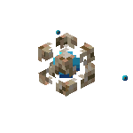

<div align="center">
    
    <h1>Conduit Agent</h1>
</div>

The agent image that runs the AI agents of the [Conduit](../README.md) mod.

Each container holds a runner that takes requests from the mod over HTTP. It answers them with
Antigravity CLI, Claude Code, Codex or OpenCode, through the
[Agent Client Protocol SDK](https://agentclientprotocol.com), the
[Claude Agent SDK](https://code.claude.com/docs/en/agent-sdk/overview), the
[Codex SDK](https://github.com/openai/codex/tree/main/sdk/typescript) or the
[OpenCode client](https://opencode.ai/docs/sdk). The runner installs the CLI into the container's
volume on first use and updates it once a day while idle, so a new CLI version needs no new image.

## Setup

1. Copy [`compose.yaml`](./compose.yaml) to the server, for example as `conduit-agents.yaml`, and
   [`.env.example`](./.env.example) next to it as `.env`. Fill in the two random secrets. Each
   needs at least 16 letters, digits or `-._~+/` characters, such as the output of
   `openssl rand -hex 24`. The file also lists the image and the resource limits.

2. Start the agents. They restart on their own, and the mod never starts or stops them.

    ```sh
    docker compose -f conduit-agents.yaml up -d
    ```

3. Give the Minecraft server the same secrets and the API keys, as the
   [mod's setup](../README.md#setup) describes, and point the mod at the containers as
   [networking](#networking) describes.

A container installs its CLI on the first request. Until the install finishes, the bot answers
requests with "try again in a few minutes".

## Credentials

By default, every run uses the API key that the mod sends with it, `agents.<mode>.apiKey`:

| CLI             | API key                                                                       |
| --------------- | ----------------------------------------------------------------------------- |
| Antigravity CLI | A Gemini API key from [Google AI Studio](https://aistudio.google.com/apikey)  |
| Claude Code     | An Anthropic API key from the [Claude Console](https://platform.claude.com/)  |
| Codex           | An OpenAI API key from the [OpenAI Platform](https://platform.openai.com/)    |
| OpenCode        | A key of the provider that the model names, such as DeepSeek for `deepseek/…` |

### Subscription logins

> [!CAUTION]
> `dangerouslyUseSubscriptionCredentials` makes the agent use the Claude, ChatGPT, Google or
> OpenCode account that its container is logged in to, for every player who asks the bot. This is
> against the terms of service of [Anthropic](https://www.anthropic.com/legal/consumer-terms),
> [OpenAI](https://openai.com/policies/terms-of-use/) and
> [OpenCode](https://opencode.ai/legal/terms-of-service). Anthropic also
> [limits how subscription logins may be used](https://code.claude.com/docs/en/legal-and-compliance#authentication-and-credential-use),
> and [Google's terms for Antigravity](https://antigravity.google/terms) apply to its Google login.
> The provider can ban the account. Use API keys instead.

To use a subscription anyway, set `agents.<mode>.dangerouslyUseSubscriptionCredentials` to `true`
in the mod's config, and log the container in to its CLI once. The login stays in the container's
volume when Compose recreates the container.

```sh
docker compose -f conduit-agents.yaml exec -it conduit-full conduit-login antigravity
docker compose -f conduit-agents.yaml exec -it conduit-full conduit-login claude
docker compose -f conduit-agents.yaml exec -it conduit-full conduit-login codex
docker compose -f conduit-agents.yaml exec -it conduit-chat conduit-login opencode
```

`conduit-login` installs the CLI first. Antigravity CLI shows a link to sign in to Google with and
asks for the code it shows. Claude Code starts its interactive login, where `/login` signs in. Codex
uses a device code, and OpenCode asks which account or provider to connect.

The agent's conversations belong to the login store they started in. Turning the flag on or off,
or switching the CLI, starts new conversations.

## Networking

The mod reaches the runner in each container, and the CLI in the container reaches the mod's MCP
server. Pick the setup that matches the server.

### Minecraft in Docker Compose

If the server runs in Docker Compose, such as with
[`itzg/minecraft-server`](https://github.com/itzg/docker-minecraft-server), start the agents in the
same project as the server, so they share its network.

```sh
docker compose -f compose.yaml -f conduit-agents.yaml up -d
```

The mod's defaults fit a server service named `minecraft`. For another name, change both `mcpUrl`
values and add the name to `mcp.allowedHosts`.

### Minecraft on the host

The runners listen on `127.0.0.1:8081` and `127.0.0.1:8082`, and the containers reach the host as
`host.docker.internal`. Point the mod's config at them:

```json
{
    "agents": {
        "full": {
            "runner": { "url": "http://127.0.0.1:8081" },
            "mcpUrl": "http://host.docker.internal:25585/mcp"
        },
        "chat": {
            "runner": { "url": "http://127.0.0.1:8082" },
            "mcpUrl": "http://host.docker.internal:25585/mcp"
        }
    }
}
```

## Resource limits

Each container may use 1 CPU and 1 GiB of memory. Set `CONDUIT_FULL_MEMORY`, `CONDUIT_CHAT_MEMORY`,
`CONDUIT_FULL_CPUS` or `CONDUIT_CHAT_CPUS` in `.env` to change these limits.

## Security

- The containers have a read-only root filesystem, no Linux capabilities, and limits on memory,
  CPU and processes.
- They can reach the internet, because the CLI needs its model's API. `agents.<mode>.web` decides
  whether the agent may also search and fetch the web.
- The runner turns off the CLI's own tools, such as shell commands and file edits, so the agent
  only has the Conduit tools.

## Building

```sh
docker build -t conduit-agent agent/
```

Set `CONDUIT_AGENT_IMAGE=conduit-agent` for the compose file to use the local image.

The runner's tests need [Bun](https://bun.sh). They put fakes in place of the CLIs, so they start
no CLI and need no API keys or logins. `bun run check` checks the types.

```sh
cd agent
bun install
bun test
```
